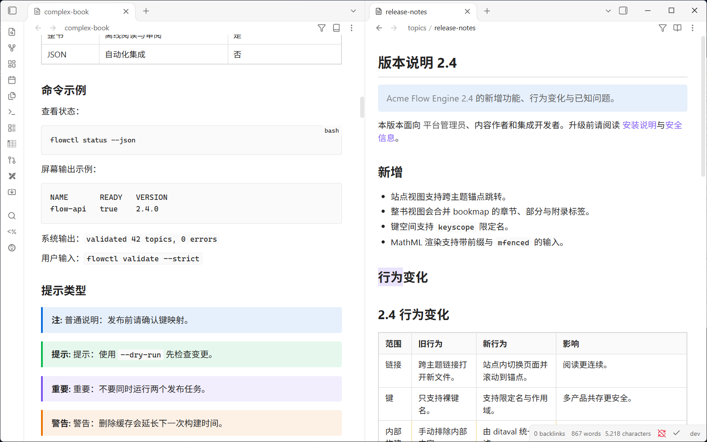

# DITA Viewer

Read and edit DITA topics and maps in Obsidian. `.dita` files open in a
formatted reading view and `.ditamap` files in an outline tree, as a small
site with one topic per page, or as a whole book; all take their colours, fonts
and heading style from whichever theme you use.

Built on [`@dita-viewer/core`](https://www.npmjs.com/package/@dita-viewer/core), the
same rendering engine as the
[VS Code DITA Viewer](https://github.com/aREversez/VS-Code-DITA-Viewer), whose
repository holds its source (`packages/core`).



## Status

**Preview and editing** of `.dita` topics and `.ditamap` maps, desktop only.

Works: all topic types and specializations the core renders, `keyref` /
`conkeyref` against the ditamap near the topic, `conref` / `conrefend`
(including content from other files, and re-render when those change), images
inside the vault, MathML, links between topics, light and dark themes, and
editing the XML source with view modes (below), tag / attribute / value
completion in the editor, source diagnostics (well-formedness, references to
nothing, duplicate ids), Ctrl/Cmd+click on a reference to open its target,
conref "jump to source" in the preview, wrap and insert commands, the
`.ditamap` outline, site and book views (below), conditional processing with
a `.ditaval` or hand-picked values (below), and a quick switcher for `.dita` /
`.ditamap` files.

Not yet: Git compare, DITA-OT. Mobile is not supported because the core reads
files through Node.

## View modes

A `.dita` file opens in one of three modes, like a Markdown note; a `.ditamap`
has two more. Use the button in the pane header, the pane's "more options"
menu, or a command:

| Mode | What you see |
| --- | --- |
| **Reading view** | The formatted topic, or the map outline. |
| **Source mode** | The XML in an editor: syntax highlighting, line numbers, auto-closing tags and quotes, search, undo history. |
| **Live preview (side by side)** | Source on the left, preview on the right. The preview updates shortly after you stop typing and keeps the last good render while the XML is invalid (an error bar says what is wrong). Scrolling or moving the caret in the source scrolls the preview to the same place; clicking an element in the preview puts the caret on its source. |
| **Site view** (maps only) | One topic per page with a sidebar of the whole map. The sidebar shows nested topicheads and bookmap division labels; click a row, or use the previous/next buttons in the pane header, to change page. A cross-topic `xref` to another topic in the map switches to that page and scrolls to the target. Right-click the page to reveal its topic's source at the clicked line. |
| **Book view** (maps only) | Every topic the map references, in map order, merged into one reading page with its bookmap chapter/appendix labels. A cross-topic `xref` to another topic in the same book scrolls to that section instead of opening a file. Right-click a section to reveal that topic's source at the clicked line. |

Commands (all under "DITA Viewer:"): *Reading view*, *Source mode*, *Live
preview (side by side)*, *Site view* (on a map), *Book view* (on a map),
*Toggle reading view and source mode*, *Wrap selection in an element*, *Insert
a structure*, and *Quick switch to a DITA file*. No hotkeys are assigned; set
your own under Settings → Hotkeys. Settings has the default mode for newly
opened files and the live-preview delay. Each pane remembers the mode you last
chose for it.

In the source, Ctrl/Cmd+click an `href`, `conref` or `keyref` to open the file
or key it names; in the preview, click the reuse badge on conref'd content to
show where it comes from. Diagnostics underline XML errors, references that
point at nothing and duplicate ids, with the message on hover and a dot in the
line-number gutter. A reference is re-checked when the file or key map it
depends on changes on disk, so fixing the target clears the warning without
reopening the document.

Edits are saved by Obsidian as for any text file, and a change to the file on
disk is merged into the open editor without moving your caret.

## Completion

In the source editor, completion pops up as you type:

- after `<`: elements, with the usual children of the enclosing element first
  (`<ul><` offers `li`; `<steps><` offers `step`); every other element is still
  there. After `</` it offers the element to close. In a `.ditamap` the map
  vocabulary is used.
- inside a tag: attributes that are not already written. Picking one inserts
  `name=""` with the caret between the quotes, and opens the value list where
  there is one.
- inside a value: enumerated values (`note type`, `scope`, `processing-role`, …),
  keys from the map for `keyref` / `conkeyref`, topics and maps for `href` /
  `conref`, images for `<image href>`, and element ids after `#`. Files are
  searched below the document's folder, three levels deep, never outside the
  vault.

## Map outline

A `.ditamap` opens in the same modes, plus **Site view** and **Book view**
(both described above: one topic per page with a sidebar, or the whole map
merged into one page). Reading view shows the outline tree: navtitles (or the
file name when the map does not name an entry), bookmap division badges
(`第 1 章` / `Chapter 1`, following the Obsidian language), nested submaps,
key definitions and reltables. Click an entry to open its topic; Ctrl/Cmd-click
opens it in a new tab. Right-click an entry for *Open* and *Reveal in source*:
the source opens beside the preview, so the outline stays in view, with the
caret on that `topicref` in the map. An entry pulled in from a referenced
submap has no line in this map, so it opens that topic's own source instead.
After a reveal, a Back button appears in the pane header, and the right-click
menu offers *Back to Reading view*, *Back to Site view* or *Back to Book view*
to return where you were. The outline re-renders when a referenced submap
changes. Side by side, the outline follows your typing; clicking in it does not
move the source caret.

## Outline pane

Obsidian's own Outline pane lists the headings of the DITA file you have open:
for a topic, its title, nested topics and every titled section and example; for
a `.ditamap`, the map's title with the `topicref` hierarchy under it (the
navtitle, or the file name when the map names none; key definitions, whatever
is marked `resource-only` (with the entries under it) and the containers a
bookmap wraps its frontmatter / backmatter in are left out). A title that
carries `keyref` is read with the map's key values, the same way the preview
reads it, so a product name in a bookmap title shows up there too. Click a row
to go there: the
preview scrolls to it in reading view, and with the source showing the caret
moves to that line. The list follows your typing after a short pause and keeps
the last good one while the XML is not well-formed. The row for the heading
under the caret is not highlighted, and "follow cursor" does nothing for DITA
files.

Obsidian offers plugins no way to feed the Outline, so this plugin wraps two
methods of the Outline view. If a future Obsidian changes them, the plugin
leaves the Outline alone and DITA files show "No headings found" there, as
before; nothing else is affected.

## Find in the preview

Ctrl/Cmd+F in the preview (reading, split, site and book views) opens a find
bar at the top right. Matches are highlighted, the current one in the accent
colour; Enter and Shift+Enter (or the arrows) step through them, the `Aa`
button matches case, Esc closes. A phrase is found across inline markup and
line breaks, but not from one paragraph into the next, and text the
conditional processing filter has hidden is not searched. The matches follow
the page as you edit or change the filter. A selection in the preview becomes
the query. With only the source showing, Ctrl/Cmd+F opens the editor's own
search.

## Hover preview

Hold Ctrl/Cmd over a link in the preview that leads to another DITA file (an
xref, a related link, an entry of a map's outline) and a popover shows that
file, scrolled to the element the link names. It is Obsidian's own Page
Preview popover: whether Ctrl/Cmd is needed is Settings > Page preview >
DITA Viewer. The same preview serves a `.dita` or `.ditamap` anywhere Obsidian
shows one, and `![[topic.dita]]` in a note embeds the topic (a map shows its
outline). Obsidian keeps its embed registry out of the public API; if a future
version removes it the plugin registers nothing and DITA links simply do not
preview.

## Conditional processing

Content marked with `audience`, `platform`, `product`, `otherprops`, `props`
(including `props="audience(admin)"` groups) and the other profiling attributes
is tinted and labelled in the preview. The **filter** button in the pane header
(or the command *Show or hide the conditional processing panel*) opens a panel
to leave content out of the preview:

- **DITAVAL**: choose a `.ditaval` from the vault (command *Apply a DITAVAL
  file*; *Clear the DITAVAL file* removes it). Its `exclude` rules hide content
  the way DITA-OT would leave it out of a build. The file is found by walking
  the vault folder, so it need not be a file type Obsidian lists. Editing it
  updates the preview if Obsidian reports the change; otherwise the next
  re-render picks it up. A file that is not well-formed XML is reported and
  not applied.
- **Values**: every attribute value on the page, ticked while it stays. Untick
  one to hide it. Values the `.ditaval` excludes show as unticked and cannot
  be ticked here; the file decides.
- **Highlight profiled content** switches the tint and label off, for a clean
  read without hiding anything.

The rules are DITA-OT's: an element is left out when *every* value of one
attribute is excluded (`audience="internal admin"` stays if `admin` is not
excluded); a `<prop att="x" action="exclude"/>` without a `val` is the default
for the values of `x` that have no rule of their own; `flag`, `passthrough` and
`<revprop>` never remove content. A `.ditaval` acts on `audience`, `platform`,
`product`, `otherprops`, `props` and attributes named in `props` groups, as
DITA-OT does; `base`, `importance`, `rev` and `status` can only be hidden by
hand.

In the outline, rows are hidden in place. In Site and Book view, a `topicref`
the filter leaves out is dropped with its sub-topics, from the page and from
the sidebar, along with hidden content inside the topics. The filter belongs
to the pane and is saved with the workspace layout. It does not change the
files, and does not touch the source editor.

## Install

**Desktop only.** The plugin reads files through Node (`fs`), so it does not
run on Obsidian mobile, and it needs a vault stored on the local file system.

### With BRAT (before the plugin is in the community directory)

1. Install **Obsidian42 - BRAT** from Community plugins.
2. BRAT → *Add beta plugin*, enter `aREversez/obsidian-dita`.
3. Enable **DITA Viewer** under Settings → Community plugins.

BRAT installs the latest GitHub release and offers updates as new ones appear.

### By hand

Download `main.js`, `manifest.json` and `styles.css` from the latest
[release](https://github.com/aREversez/obsidian-dita/releases) into
`<vault>/.obsidian/plugins/dita-viewer/`, then enable **DITA Viewer**. To build
them yourself:

```
npm install
npm run build
```

and copy `packages/obsidian-plugin/dist/{main.js,manifest.json,styles.css}`.

## How it follows your theme

Community themes restyle almost everything, so the preview is built so that a
theme can influence it only in ways it is meant to.

1. **Shadow DOM isolation.** The topic renders inside a shadow root. Theme
   selectors (`.markdown-rendered table`, bare `code`, `a`, `blockquote`, a
   snippet that styles `.view-content *`) cannot reach in, so tables, code
   blocks and callouts keep their structure in every theme.
2. **Variables pass through.** Obsidian defines its design variables on
   `<body>`; custom properties inherit across the shadow boundary. The adapter
   ([`obsidian-adapter.css`](packages/obsidian-plugin/src/theme/obsidian-adapter.css))
   is the only file that knows Obsidian's variable names. It maps them to the
   core's 12 host tokens ([`TOKENS.md`](https://github.com/aREversez/VS-Code-DITA-Viewer/blob/dev/packages/core/styles/TOKENS.md)):
   text, background, border, link and code colours, body font, font size,
   line height, readable line width, and the theme's heading sizes, weights,
   fonts and colours.
3. **The source editor follows the theme too.** Its colours are Obsidian's
   own variables (`--code-tag`, `--code-property`, `--code-string`,
   `--code-comment`, `--text-selection`, `--font-monospace`, …); none is written
   into the plugin.
4. **Derived, not hard-coded, colours.** Note/warning/danger/tip panels, the
   conditional-processing highlight and index chips are `color-mix()` of the
   theme's own palette against its own background. They are therefore right in
   light and dark, and in themes nobody tested.
5. **Contrast is tested.** `test/theme.test.ts` resolves the adapter against
   nine theme archetypes (default light/dark, warm paper, Solarized, AMOLED
   black, neon, pastel, high contrast) and checks that body text stays at WCAG
   AA on every derived background, and that no `--vscode-*` leaks into either
   stylesheet.
6. **You can override anything.** Outer CSS wins over the shadow root's
   `:host` rules, so a snippet needs no specificity tricks:

   ```css
   .dita-view {
     --dita-link: #c2410c;
     --dita-note-bg: #eef3ff;
     --dita-max-width: 60rem;
   }
   ```

   Hooks: every `--dita-*` host token, `--dita-max-width`, and
   `--dita-{note,warning,danger,important,tip}-{bg,border}`.

The archetypes are *shapes* of themes, not copies of real ones; checking a
specific theme (Minimal, Things, AnuPpuccin, Sanctum, …) still needs a look in
Obsidian itself.

See [ROADMAP.md](ROADMAP.md) for what is planned next and the working rules.

## Layout

```
packages/obsidian-plugin  the Obsidian plugin: view, theme adapter, build
```

The rendering core, `@dita-viewer/core`, is installed from npm and pinned in
`packages/obsidian-plugin/package.json`. Its source is in the VS Code DITA
Viewer repository (`packages/core`), where it is edited and released with a
`core-<version>` tag. To take a change, raise the pinned version and run
`npm install` and `npm run verify`.

## Development

```
npm run verify      # typecheck, all tests, bundle
npm run watch -w obsidian-dita
```

`npm run build` also copies the bundle into the local test vault at
`test-dita-file/.obsidian/plugins/dita-viewer` when that folder exists; the
watch command does the same after each successful rebuild. Use `npm run
sync:test` to copy the current bundle without rebuilding, or set
`DITA_TEST_VAULT_PLUGIN` to a different plugin folder.

## Releasing

The version lives in `manifest.json` (repository root), `versions.json` and
the plugin's `package.json`; `npm run release:check` (part of `verify`) fails
when they disagree. The built `main.js`, `styles.css` and `manifest.json` are
committed at the repository root, where the Obsidian submission and its
reviewers look for them.

```
npm run release:ship -- 0.3.0         # bump, verify, sync the root files, commit, tag
git push && git push origin 0.3.0    # nothing is pushed for you
```

`--dry-run` runs the checks and prints the commands without executing them. The
ship step refuses a dirty working tree, a detached HEAD and a version whose tag
already exists locally or on origin.

Step by step, which is what `release:ship` runs:

```
npm version 0.3.0 -w obsidian-dita --no-git-tag-version   # also updates manifest.json and versions.json
npm run release:prepare                                   # build, then refresh the root copies
npm run verify; npm run sync:root:check                   # everything CI will demand, locally first
git commit -am "chore: release 0.3.0"
git tag 0.3.0
```

`git push --follow-tags` skips lightweight tags, so the tag is pushed by name.
The build inlines the stylesheets, so a CRLF checkout produces a `main.js` that
differs from a CI build; `.gitattributes` keeps every checkout LF and
`sync:root:check` in CI fails a branch whose root copies drifted from the build.

Pushing the tag runs `.github/workflows/release.yml`: it runs `npm run verify`,
checks that the tag equals the manifest version (bare `0.3.0`, no `v`), rebuilds
and syncs the root copies in the runner's own working tree, and publishes a
GitHub release with `main.js`, `manifest.json` and `styles.css` attached at the
flat root paths the installer downloads, so the attached bundle is the one that
runner built. The workflow writes nothing to git. Raise `minAppVersion` in
`manifest.json` before the bump if a release starts to need a newer Obsidian;
`versions.json` records it per version.

## Sample document

[`test-dita-file/`](test-dita-file/) is a DITA 1.3 bookmap fixture for trying
Site and Book view: topics, tasks, concepts, references, troubleshooting,
glossaries, a Learning specialization, keys and key scopes,
`conref`/`conkeyref`/`conrefend`, a ditaval, imagemaps, hazard statements and
MathML. Open `test-dita-file/complex-book.ditamap`, or see
[`test-dita-file/README.md`](test-dita-file/README.md) for the topic list and
validation commands.

## License

MIT
